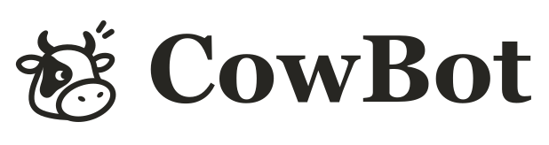
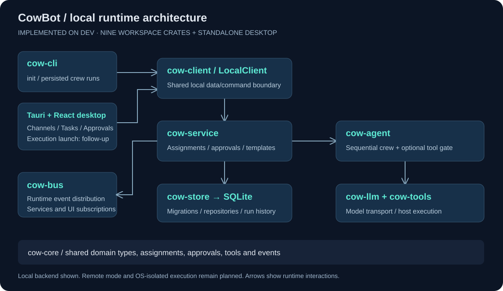
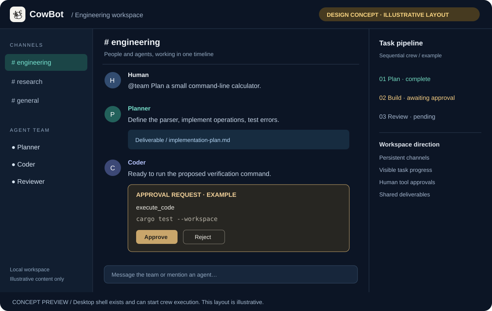

<p align="center">
  <picture>
    <source media="(prefers-color-scheme: dark)" srcset="assets/brand/cowai-wordmark-dark.svg">
    <source media="(prefers-color-scheme: light)" srcset="assets/brand/cowai-wordmark-light.svg">
    
  </picture>
</p>

<p align="center">
  <strong>Agents that work together. A workspace you control.</strong><br>
  An open-source, local-first multi-agent collaboration platform built in Rust.
</p>

<p align="center">
  <a href="LICENSE"></a>
  <a href="docs/ROADMAP.md"></a>
  <a href="CONTRIBUTING.md"></a>
</p>

<p align="center">
  <a href="#quick-start">Quick start</a> ·
  <a href="#what-works-today">Features</a> ·
  <a href="docs/ARCHITECTURE.md">Architecture</a> ·
  <a href="docs/ROADMAP.md">Roadmap</a> ·
  <a href="assets/README.md">Brand assets</a>
</p>

---

CowBot brings role-based agent teams, tasks, and channel-based collaboration into one modular platform. It draws on [CrewAI](https://github.com/crewAIInc/crewAI)'s role-and-task orchestration and [Mattermost](https://github.com/mattermost/mattermost)'s channel-based collaboration model.

The Rust runtime and CLI work today. The local desktop experience is being built incrementally, with self-hosted team mode planned after the local MVP.

## What works today

| Capability | Available now |
| --- | --- |
| Agent crews | Roles, goals, backstories, tool-calling loops, and sequential workflows with context chaining |
| Assignment runtime | Task trees, lifecycle event logs, budgets, stall guards, and restart reconciliation |
| Local persistence | Embedded SQLite migrations and repositories for workspaces, channels, agents, tasks, and audit events |
| Collaboration services | Idempotent local owner/workspace bootstrap; channel and message persistence connected to the event bus |
| Agent and team templates | Built-in JSON templates, validation, template management, and `.cowtemplate` import/export |
| Desktop shell | React channels/messages, task creation and history, cancellation, and pending approval decisions via Tauri |
| Tools | Subprocess execution and file operations with execution timeouts and output limits |
| Approvals | Static risk classification, Ask/SafeAuto/PlanOnly/Trusted modes, pending approvals, and audit records |
| Model providers | OpenAI-compatible endpoints, including DeepSeek, Ollama, and OpenRouter; mock providers for offline testing |

**In progress:** Phase 1 milestones 1.1–1.5 are implemented. Milestone 1.6 includes a local client and a Tauri desktop shell with Channels, Tasks, and Approvals views. Starting execution from the desktop, agents/templates management, settings, packaging, and `.cowpkg` import/export remain follow-up work. See the [roadmap](docs/ROADMAP.md) for scope and acceptance criteria.

## Naming and compatibility

**CowBot** is the new product name used in this documentation. The software rename will be implemented separately: the current executable and help output still use `cowai`, and the current desktop may still display CowAI. Commands below intentionally match the existing software.

The GitHub repository remains at `BerryUIKI/CowAI`. Crate/package names, `COWAI_DB`, `cowai.db`, the desktop identifier `com.cowai.desktop`, internal `cowai-event` channel, and existing asset filenames remain unchanged. Documentation wordmarks show CowBot; application assets will be updated by the implementation team.

## Quick start

Install the [Rust toolchain](https://rustup.rs/), then build from the integration branch:

```bash
git clone --branch dev https://github.com/BerryUIKI/CowAI.git CowBot
cd CowBot
cargo build --workspace --locked
```

### Initialize local storage

```sh
cargo run -p cow-cli -- init --db cowai.db
```

Both `init` and `run` migrate SQLite, bootstrap the local workspace, and reconcile interrupted assignments and approvals. Database selection is `--db`, then `COWAI_DB`, then `cowai.db` in the current directory. Runs persist tasks, assignments, tool calls, approvals, and audit records.

### Try an agent crew offline

The mock provider runs without an API key. It echoes mock deliverables through the three-task pipeline; it does not implement the requested program. Dry runs still initialize storage and record run history:

```bash
cargo run -p cow-cli -- run \
  --task "Plan a REST API for a task tracker" \
  --dry-run
```

### Connect a model

With an OpenAI API key, run a task against a live model:

```bash
export OPENAI_API_KEY="your-api-key"
cargo run -p cow-cli -- run \
  --task "Implement a snake game in Python" \
  --model gpt-4o
```

For a local Ollama endpoint, use an installed model:

```bash
cargo run -p cow-cli -- run \
  --task "Analyze log files" \
  --base-url "http://localhost:11434/v1" \
  --model "llama3"
```

These examples use a POSIX shell. In PowerShell, set the key with `$env:OPENAI_API_KEY = "your-api-key"` and put each `cargo run` command on one line.

### Explore the CLI

```bash
cargo run -p cow-cli -- --help
cargo run -p cow-cli -- tools
```

### Approval policies and execution boundaries

`run --approval <ask|safe-auto|plan-only|trusted>` defaults to `ask`. Approval requests prompt `y/N` and decisions are persisted with the session user. Non-interactive callers should choose a policy deliberately; `ask` can wait for input, EOF rejects, and requests can time out. See [ADR 0003](docs/ADR/0003-risk-classification-and-approval.md) and [ADR 0008](docs/ADR/0008-cli-and-local-execution.md) for policy and execution semantics.

The subprocess backend runs host commands with the current user's permissions. Approval policies, timeouts, and output limits do not provide OS isolation or filesystem containment. Treat model-generated commands as untrusted; see [Security](SECURITY.md).

### Try the desktop shell

```sh
cd desktop
npm ci
npm run tauri dev
```

Install Node.js/npm and the platform's Tauri native prerequisites first; see [Desktop setup](desktop/README.md). Desktop data is stored in the app-data directory, separate from the CLI's default database. The shell supports channels, task creation/inspection/cancellation, and approvals; it does not start task execution yet.

## Architecture



Nine focused crates keep the domain model, runtime, and application services separate:

| Crate | Responsibility |
| --- | --- |
| [`cow-core`](crates/cow-core) | Domain models, assignments, tools, and events |
| [`cow-bus`](crates/cow-bus) | Tokio broadcast event bus and in-memory event history |
| [`cow-tools`](crates/cow-tools) | Tool registry, subprocess sandbox, and file tools |
| [`cow-llm`](crates/cow-llm) | OpenAI-compatible client and mock providers |
| [`cow-agent`](crates/cow-agent) | Agent execution loops, roles, and crew orchestration |
| [`cow-store`](crates/cow-store) | SQLite migrations, persistence, and repositories |
| [`cow-client`](crates/cow-client) | Transport-neutral client and local backend shared by CLI and desktop |
| [`cow-service`](crates/cow-service) | Local bootstrap, collaboration, templates, and assignment services |
| [`cow-cli`](crates/cow-cli) | The `cowai` command-line interface |

Read the [functional and system architecture](docs/ARCHITECTURE.md) for the planned desktop and server boundaries.

## Workspace concept



**Illustrative SVG, not an application screenshot.** It visualizes the channel-first direction. The current shell already has Channels, Tasks, and Approvals views; integrated desktop execution and this exact layout are not implemented.

## Documentation

Start with the [documentation index](docs/README.md), [developer guide](docs/DEVELOPMENT.md), [contribution guide](CONTRIBUTING.md), and [collaboration workflow](docs/COLLABORATION.md).

| Guide | Purpose |
| --- | --- |
| [Product requirements](docs/PRD.md) | Users, workflows, and product scope |
| [Architecture](docs/ARCHITECTURE.md) | Functional domains and system design |
| [Roadmap](docs/ROADMAP.md) | Local MVP → self-hosted teams → ecosystem extensions |
| [Architecture decisions](docs/ADR) | Recorded design decisions and tradeoffs |
| [Template format](docs/TEMPLATE_FORMAT.md) | Agent and team template schema |
| [Design references](docs/REFERENCES.md) | External references informing the platform |
| [Brand assets](assets/README.md) | Canonical icon, exports, and asset maintenance |

## Development

Run the workspace quality checks before submitting code changes:

```bash
cargo fmt --check
cargo clippy --workspace --all-targets -- -D warnings
cargo test --workspace
```

Keep contributions small and focused. Branch from `dev` using `feature/<name>` and open pull requests against `dev`. `main` is the release branch; releases are promoted separately. Repository documentation, code, and commit messages use English. See [CLAUDE.md](CLAUDE.md) for development conventions.

Report reproducible bugs and discuss proposals through [GitHub Issues](https://github.com/BerryUIKI/CowAI/issues). Follow the [Code of Conduct](CODE_OF_CONDUCT.md); use [Security](SECURITY.md) for vulnerability reporting. Maintainers can use the [release checklist](docs/RELEASING.md).

## License

CowBot is licensed under the [Apache License, Version 2.0](LICENSE). All nine workspace crates and the standalone desktop package declare Apache-2.0. Third-party dependencies retain their own licenses.
