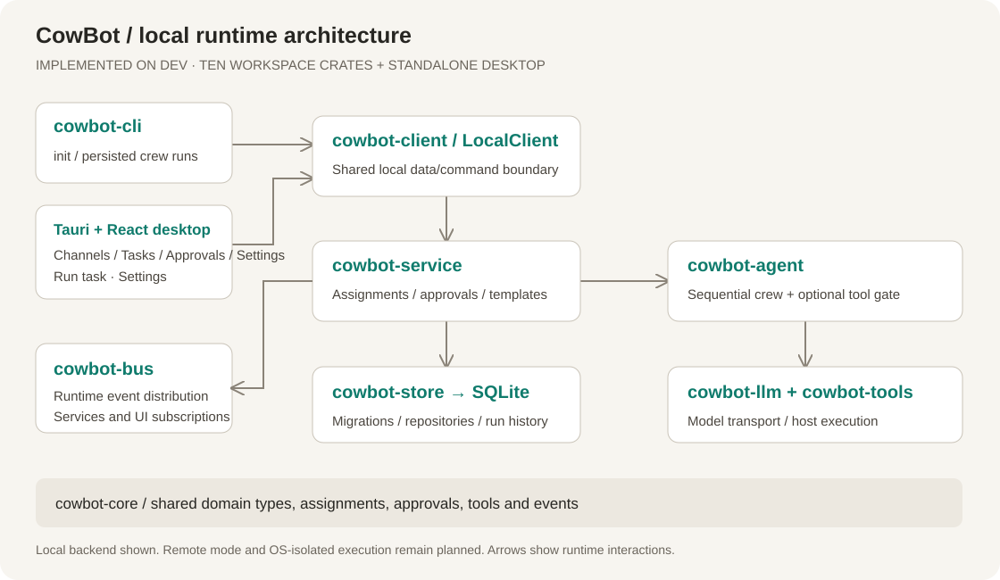
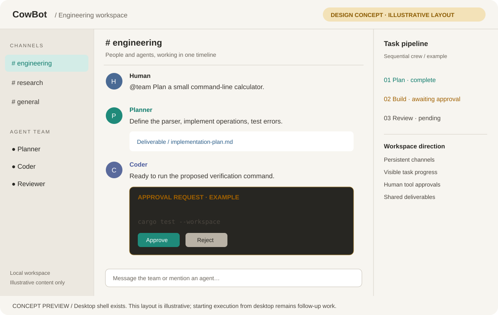

<p align="center">
  <picture>
    <source media="(prefers-color-scheme: dark)" srcset="assets/brand/cowbot-wordmark-dark.svg">
    <source media="(prefers-color-scheme: light)" srcset="assets/brand/cowbot-wordmark-light.svg">
    
  </picture>
</p>

<p align="center">
  <strong>Agents that work together. A workspace you control.</strong><br>
  An open-source, local-first multi-agent collaboration platform built in Rust.
</p>

<p align="center">
  <a href="LICENSE"></a>
  <a href="docs/ROADMAP.md"></a>
  <a href="CONTRIBUTING.md"></a>
</p>

<p align="center">
  <a href="https://github.com/BerryUIKI/CowBot/releases">Download</a> ·
  <a href="#quick-start">Quick start</a> ·
  <a href="#what-works-today">Features</a> ·
  <a href="docs/ARCHITECTURE.md">Architecture</a> ·
  <a href="docs/ROADMAP.md">Roadmap</a> ·
  <a href="assets/README.md">Brand assets</a>
</p>

---

CowBot brings role-based agent teams, tasks, and channel-based collaboration into one modular platform. It draws on [CrewAI](https://github.com/crewAIInc/crewAI)'s role-and-task orchestration and [Mattermost](https://github.com/mattermost/mattermost)'s channel-based collaboration model.

The Rust runtime and CLI work today. The local desktop experience is being built incrementally, with self-hosted team mode planned after the local MVP.

## What works today

| Capability | Available now |
| --- | --- |
| Agent crews | Roles, goals, backstories, tool-calling loops, and sequential workflows with context chaining |
| Assignment runtime | Task trees, lifecycle event logs, budgets, stall guards, and restart reconciliation |
| Local persistence | Embedded SQLite migrations and repositories for workspaces, channels, agents, tasks, and audit events |
| Collaboration services | Idempotent local owner/workspace bootstrap; channel and message persistence connected to the event bus |
| Agent and team templates | Built-in JSON templates, validation, template management, and `.cowtemplate` import/export |
| Desktop shell | First-run onboarding; React channels/messages, task creation and history, run history and tool calls, cancellation, pending approval decisions, crew execution from a task, and switchable model-provider plus agents/templates settings via Tauri |
| Desktop installers | Unsigned NSIS/MSI, universal DMG, and deb/AppImage builds from the release workflow |
| Tools | Subprocess execution and file operations with execution timeouts and output limits |
| Approvals | Static risk classification, Ask/SafeAuto/PlanOnly/Trusted modes, pending approvals, and audit records |
| Workspace packages | `.cowpkg` export and verified import with SHA-256 checksums, via the CLI |
| Model providers | OpenAI-compatible endpoints, including DeepSeek, Ollama, and OpenRouter; mock providers for offline testing |

**In progress:** Phase 1 milestones 1.1–1.5 are implemented. Milestone 1.6 includes a local client and a Tauri desktop shell with Channels, Tasks, Approvals, and Settings views, switchable model providers, desktop-initiated crew execution, and first-run onboarding. Milestone 1.7 adds `.cowpkg` workspace export/import through the CLI plus unsigned desktop installers from the release workflow. Desktop import/export, user documentation, installer signing, and remote mode remain follow-up work. See the [roadmap](docs/ROADMAP.md) for scope and acceptance criteria.

## Naming and compatibility

**CowBot** is the product and software name. The executable is `cowbot`, the desktop bundle and window use CowBot, local storage defaults to `cowbot.db`, and the database environment variable is `COWBOT_DB`.

The CLI rename is a clean break: it no longer reads `COWAI_DB` or falls back to `cowai.db`. Rename an existing database (`mv cowai.db cowbot.db`) or pass `--db`. The desktop application copies a database from the previous `com.cowai.desktop` app-data directory on first launch, so existing desktop data is preserved automatically.

## Install

Desktop installers are built by the [release workflow](.github/workflows/release.yml) and published on the [Releases](https://github.com/BerryUIKI/CowBot/releases) page when a maintainer publishes a version:

- **Windows:** NSIS `.exe` and `.msi`
- **macOS:** universal `.dmg` for Apple Silicon and Intel
- **Linux:** `.deb` and `.AppImage`

Builds are unsigned: macOS may require allowing the app in System Settings, and Windows may show a SmartScreen prompt. See [ADR-0014](docs/ADR/0014-desktop-release-builds.md) for the release policy. Until a release is published, build from source with the quick start below.

## Quick start

Install the [Rust toolchain](https://rustup.rs/), then build from the integration branch:

```bash
git clone --branch dev https://github.com/BerryUIKI/CowBot.git CowBot
cd CowBot
cargo build --workspace --locked
```

### Initialize local storage

```sh
cargo run -p cowbot-cli -- init --db cowbot.db
```

Both `init` and `run` migrate SQLite, bootstrap the local workspace, and reconcile interrupted assignments and approvals. Database selection is `--db`, then `COWBOT_DB`, then `cowbot.db` in the current directory. Runs persist tasks, assignments, tool calls, approvals, and audit records.

### Try an agent crew offline

The mock provider runs without an API key. It echoes mock deliverables through the three-task pipeline; it does not implement the requested program. Dry runs still initialize storage and record run history:

```bash
cargo run -p cowbot-cli -- run \
  --task "Plan a REST API for a task tracker" \
  --dry-run
```

### Connect a model

With an OpenAI API key, run a task against a live model:

```bash
export OPENAI_API_KEY="your-api-key"
cargo run -p cowbot-cli -- run \
  --task "Implement a snake game in Python" \
  --model gpt-4o
```

For a local Ollama endpoint, use an installed model:

```bash
cargo run -p cowbot-cli -- run \
  --task "Analyze log files" \
  --base-url "http://localhost:11434/v1" \
  --model "llama3"
```

These examples use a POSIX shell. In PowerShell, set the key with `$env:OPENAI_API_KEY = "your-api-key"` and put each `cargo run` command on one line.

### Explore the CLI

```bash
cargo run -p cowbot-cli -- --help
cargo run -p cowbot-cli -- tools
```

### Move a workspace between installations

Workspaces travel as `.cowpkg` packages — verified ZIP archives that never carry
credentials:

```bash
cargo run -p cowbot-cli -- export --output my-workspace.cowpkg --db cowbot.db
cargo run -p cowbot-cli -- import --input my-workspace.cowpkg --db other.db
```

Import always creates a new workspace named `<original> (imported)`; existing
workspaces are never modified or merged. See [the package format](docs/PACKAGE_FORMAT.md).

### Approval policies and execution boundaries

`run --approval <ask|safe-auto|plan-only|trusted>` defaults to `ask`. Approval requests prompt `y/N` and decisions are persisted with the session user. Non-interactive callers should choose a policy deliberately; `ask` can wait for input, EOF rejects, and requests can time out. See [ADR 0003](docs/ADR/0003-risk-classification-and-approval.md) and [ADR 0008](docs/ADR/0008-cli-and-local-execution.md) for policy and execution semantics.

The subprocess backend runs host commands with the current user's permissions. Approval policies, timeouts, and output limits do not provide OS isolation or filesystem containment. Treat model-generated commands as untrusted; see [Security](SECURITY.md).

### Try the desktop shell

```sh
cd desktop
pnpm install
pnpm run tauri dev
```

Install Node.js 22.13+, pnpm, and the platform's Tauri native prerequisites first; see [Desktop setup](desktop/README.md). Desktop data is stored in the app-data directory, separate from the CLI's default database. The shell supports channels, task creation, crew execution, approvals, and agents/templates settings. Model selection, workspace import/export, and installer packaging are not implemented yet.

## Architecture

<p align="center">
  <picture>
    <source media="(prefers-color-scheme: dark)" srcset="docs/assets/architecture.svg">
    <source media="(prefers-color-scheme: light)" srcset="docs/assets/architecture-light.svg">
    
  </picture>
</p>

Ten focused crates keep the domain model, runtime, and application services separate:

| Crate | Responsibility |
| --- | --- |
| [`cowbot-core`](crates/cowbot-core) | Domain models, assignments, tools, and events |
| [`cowbot-bus`](crates/cowbot-bus) | Tokio broadcast event bus and in-memory event history |
| [`cowbot-tools`](crates/cowbot-tools) | Tool registry, subprocess sandbox, and file tools |
| [`cowbot-llm`](crates/cowbot-llm) | OpenAI-compatible client and mock providers |
| [`cowbot-agent`](crates/cowbot-agent) | Agent execution loops, roles, and crew orchestration |
| [`cowbot-store`](crates/cowbot-store) | SQLite migrations, persistence, and repositories |
| [`cowbot-client`](crates/cowbot-client) | Transport-neutral client and local backend shared by CLI and desktop |
| [`cowbot-package`](crates/cowbot-package) | `.cowpkg` workspace packages with checksums and verified import |
| [`cowbot-service`](crates/cowbot-service) | Local bootstrap, collaboration, templates, and assignment services |
| [`cowbot-cli`](crates/cowbot-cli) | The `cowbot` command-line interface |

Read the [functional and system architecture](docs/ARCHITECTURE.md) for the planned desktop and server boundaries.

## Workspace concept

<p align="center">
  <picture>
    <source media="(prefers-color-scheme: dark)" srcset="docs/assets/workspace-concept.svg">
    <source media="(prefers-color-scheme: light)" srcset="docs/assets/workspace-concept-light.svg">
    
  </picture>
</p>

**Illustrative SVG, not an application screenshot.** It visualizes the channel-first direction. The current shell already has Channels, Tasks, Approvals, and Settings views, and can start crew execution from a task; this exact layout is not implemented.

## Documentation

Start with the [documentation index](docs/README.md), [developer guide](docs/DEVELOPMENT.md), [contribution guide](CONTRIBUTING.md), and [collaboration workflow](docs/COLLABORATION.md).

| Guide | Purpose |
| --- | --- |
| [Product requirements](docs/PRD.md) | Users, workflows, and product scope |
| [Architecture](docs/ARCHITECTURE.md) | Functional domains and system design |
| [Roadmap](docs/ROADMAP.md) | Local MVP → self-hosted teams → ecosystem extensions |
| [Architecture decisions](docs/ADR) | Recorded design decisions and tradeoffs |
| [Template format](docs/TEMPLATE_FORMAT.md) | Agent and team template schema |
| [Design references](docs/REFERENCES.md) | External references informing the platform |
| [Brand assets](assets/README.md) | Canonical icon, exports, and asset maintenance |

## Development

Run the workspace quality checks before submitting code changes:

```bash
cargo fmt --check
cargo clippy --workspace --all-targets -- -D warnings
cargo test --workspace
```

Keep contributions small and focused. Branch from `dev` using `feature/<name>` and open pull requests against `dev`. `main` is the release branch; releases are promoted separately. Repository documentation, code, and commit messages use English. See [CLAUDE.md](CLAUDE.md) for development conventions.

Report reproducible bugs and discuss proposals through [GitHub Issues](https://github.com/BerryUIKI/CowBot/issues). Follow the [Code of Conduct](CODE_OF_CONDUCT.md); use [Security](SECURITY.md) for vulnerability reporting. Maintainers can use the [release checklist](docs/RELEASING.md).

## License

CowBot is licensed under the [Apache License, Version 2.0](LICENSE). All ten workspace crates and the standalone desktop package declare Apache-2.0. Third-party dependencies retain their own licenses.
